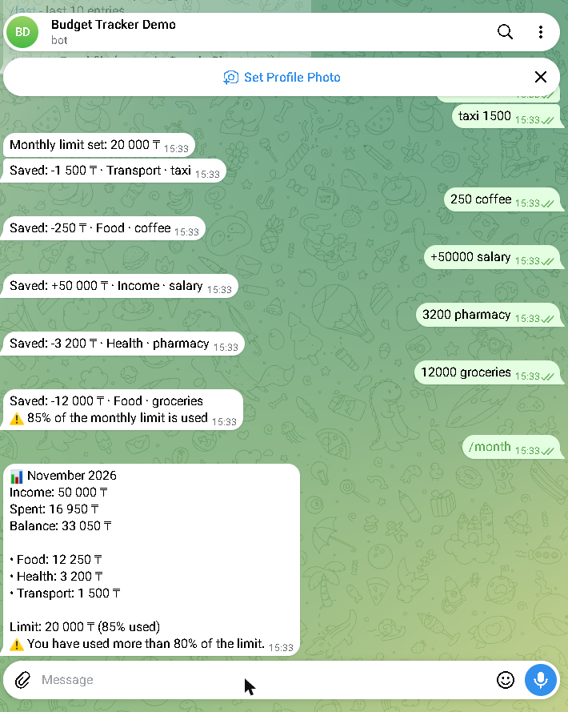
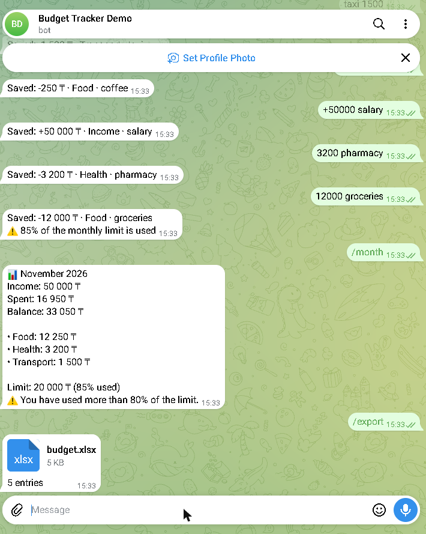

# Budget tracker bot for Telegram

[](https://github.com/zhangir777/budget-bot/actions/workflows/tests.yml)

**Hire me:** [Upwork](https://www.upwork.com/freelancers/~012c68804f9b4d4550) · [Fiverr](https://www.fiverr.com/akhmetov_zhangi) · [Telegram @ZhangirAkhmetov](https://t.me/ZhangirAkhmetov)

**[Watch the demo video (mp4)](docs/demo.mp4)**

**Live demo:** [@zhangir_budget_bot](https://t.me/zhangir_budget_bot) (runs on my demo server)

A Telegram bot for personal or small-business budget tracking. Write one line, the bot saves it:
`250 coffee` is an expense, `+50000 salary` is income.

- **One-line entries**: amount and note in any order (`taxi 1500`, `1 500 такси`, `12,5 lunch`).
  The category (Food, Transport, Home, Health, Fun, Shopping) is guessed from the note, English and Russian keywords.
- **Reports**: `/today`, `/month` (income, spending, balance, spending by category), `/last`.
- **Monthly limit**: `/limit 200000`, and the bot warns at 80% and 100% of it.
- **Undo**: `/undo` removes the last entry.
- **Excel export**: `/export` sends an `.xlsx` file with all entries. It opens in Excel and in Google Sheets
  (upload it or use File → Import). The bot does not sync with Google Sheets live: that needs your Google account
  credentials, and I can add it for a client project.
- Every user has their own data. Storage is a single SQLite file, no external services.

| Add entries and monthly report | Excel export |
|---|---|
|  |  |

## Set up for a new client
1. Copy `.env.example` to `.env` and put the `BOT_TOKEN` from @BotFather.
2. Change categories and keywords in `bot/parser.py` and the currency `CUR` in `bot/main.py`.

## Run
```bash
pip install -r requirements.txt
python -m bot.main
```

## Tests
```bash
pip install pytest
python -m pytest -q
```
Offline tests for the parser, the SQLite store, reports and the Excel export.

## Stack
Python 3.12, aiogram 3, SQLite (stdlib), openpyxl.

## License
MIT

## На русском

Telegram-бот для учёта личного или маленького бизнес-бюджета. Пишете одну строку, бот сохраняет:
`250 кофе` — расход, `+50000 зарплата` — доход.

- Сумма и пометка в любом порядке, категория определяется по словам (русский и английский).
- `/today`, `/month` (доход, расходы, остаток, расходы по категориям), `/last`, `/undo`.
- Месячный лимит `/limit 200000` и предупреждение при 80% и 100%.
- `/export` присылает файл `.xlsx`, он открывается в Excel и в Google Sheets (загрузить или импортировать).
  Живой синхронизации с Google Sheets нет: для неё нужен доступ к Google-аккаунту заказчика, под проект я её добавлю.
- У каждого пользователя свои данные, хранение в одном файле SQLite.
